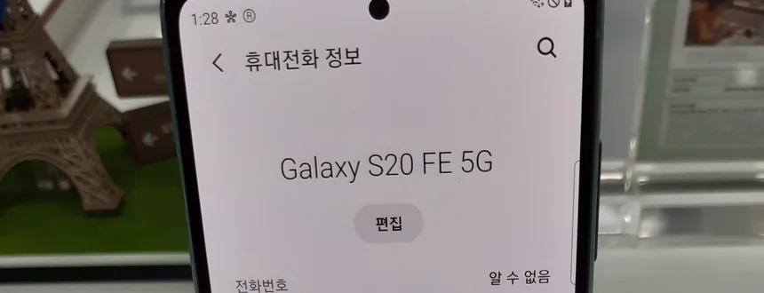
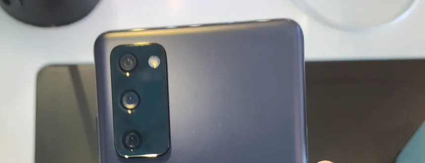

# HyperOS 4 no Galaxy S20 FE

Port comunitário do HyperOS do Xiaomi Mi 10 (`umi`) para o **Galaxy S20 FE Snapdragon** (`r8q`), com a base Vendor/ODM do port de ColorOS e adaptações para o hardware Samsung. Os modelos previstos são **SM-G780G (4G)** e **SM-G781B (5G)**. O SM-G780F usa Exynos e fica fora deste port.

**Estado do projeto · P1r5 experimental.** O flash já terminou em aparelhos de teste. O Android ainda trava na logo Samsung. Na última tentativa analisada, a `keystore2` encerrou ao procurar o serviço de chaves do ambiente seguro (TEE). O próximo teste já tem pacote próprio. [Evidência do boot e pendências](STATUS.md)

[Downloads](#downloads) · [Retomar o desenvolvimento](docs/RETOMADA.md) · [Histórico de versões](docs/HISTORICO.md) · [Mapa das 58 branches](docs/BRANCHES.md)

## Downloads

| O que você precisa | Pacote | Quando usar |
| --- | --- | --- |
| ROM completa | **[P1r5 KEYMASTER-TEE · 5,39 GB](https://gofile.io/d/hv0vq1uk)** | Base experimental para os testes. O ZIP já vem montado. Confira os pré-requisitos e o SHA-256 na [release da ROM](https://github.com/bonecopreparado/vendor-r8q/releases/tag/p1r5-keymaster-tee-experimental-5-1). |
| Diagnóstico do próximo boot | **[TEE-HAL-LOG · 17,2 MB](https://github.com/bonecopreparado/vendor-r8q/releases/download/p1r5-tee-hal-log-4-1/R8Q-P1r5-LATEFS-TEE-HAL-LOG.zip)** | Para quem **já instalou a KEYMASTER-TEE**. Altera somente o boot para registrar o início e o registro do serviço Samsung. |
| Coleta após a tentativa | [BOOTDIAG V6 COLLECT-ONLY](https://github.com/bonecopreparado/vendor-r8q/releases/download/p1r5-keymaster-tee-experimental-5-1/R8Q-BOOTDIAG-V6-COLLECT-ONLY.zip) | Rode pelo recovery depois de tentar iniciar o Android. O TAR com `PARTIAL` também pode conter o `last_kmsg`. |
| Voltar do diagnóstico | [RESTORE-KEYSTORE-LOG](https://github.com/bonecopreparado/vendor-r8q/releases/download/p1r5-tee-hal-log-4-1/R8Q-P1r5-LATEFS-RESTORE-KEYSTORE-LOG.zip) | Repõe o boot da KEYMASTER-TEE após o TEE-HAL-LOG. A ROM completa continua instalada. |

Quem já está na KEYMASTER-TEE pode começar pelo segundo item. O [roteiro de teste](docs/RETOMADA.md) traz os comandos para Windows, os hashes e o que procurar no resultado. Para compartilhar com um tester, há também [instruções da ROM em inglês](https://github.com/bonecopreparado/vendor-r8q/releases/download/p1r5-keymaster-tee-experimental-5-1/P1-TESTER-ENGLISH.txt).

## Como o projeto chegou aqui

| Etapa | O que mudou |
| --- | --- |
| **P0 · instalador** | Os primeiros testes revelaram incompatibilidades de `dd`, aritmética de 32 bits no recovery e confusão entre o ZIP de auditoria e o instalador. |
| **P1 a P1r2 · imagens e ZIP único** | A composição passou a sair em um pacote completo. Entraram ajustes de SELinux, o experimento de mapping de `system_ext/product` e a correção de leitura de links simbólicos em EROFS. |
| **P1r3 e P1r4 · kernel e Vendor** | Foram integrados os trabalhos de NFLOG, SUSFS e display. Os logs levaram a correções no scheduler, no firmware IPA e nos rótulos SELinux da Vendor. |
| **P1r5 · boot inicial** | A ROM reuniu essas mudanças. Os marcadores localizaram a espera na montagem de `/data`. A coleta seguinte mostrou a falha da `keystore2`. A investigação agora acompanha o registro do Keymaster via HIDL. |

O [histórico](docs/HISTORICO.md) reúne as releases em ordem, incluindo as revisões de coletores e os pacotes intermediários. Para consultar as instruções exatamente como eram na época de P0/P1r2, abra o [README arquivado](https://github.com/bonecopreparado/vendor-r8q/blob/17669efee036c538e10ed0d6f3f5ee524c1b3fc1/README.md).

## Onde fica o código

A `main` reúne a documentação e a base histórica P0. Para reproduzir uma build, use a revisão correspondente. As imagens grandes são entradas externas com tamanho e hash registrados nas receitas.

| Trabalho | Ponto de entrada |
| --- | --- |
| Montagem da ROM completa | [Receita da KEYMASTER-TEE](https://github.com/bonecopreparado/vendor-r8q/blob/f1351e4a92f1db4e1dfcf167acb0e8f443547350/.github/workflows/r8q-p1r5-singlezip.yml) |
| Kernel de diagnóstico e ZIP para o recovery | [Compilação do kernel](https://github.com/bonecopreparado/vendor-r8q/tree/1354a099bb6b5635b4fac0e35beecfa66f7711e0/tools/kernel_nflog/susfs22) · [Empacotamento do TEE-HAL-LOG](https://github.com/bonecopreparado/vendor-r8q/blob/2d5e365e9a4e2fa92e85b1cde058dfdad071bccf/tools/package_mount_wait.py) |
| Evidências de compatibilidade e falhas anteriores | [Relatórios P1](https://github.com/bonecopreparado/vendor-r8q/tree/f1351e4a92f1db4e1dfcf167acb0e8f443547350/reports/p1) · [Auditorias P0](reports/) |
| Ferramentas e instaladores históricos | [Ferramentas](tools/) · [Testes e entradas fixadas](ci-r8q/) · [Instaladores P0](delivery/) · [Experimentos](patches/) |

## O aparelho

| Frente do Galaxy S20 FE 5G | Conjunto de câmeras traseiras |
| --- | --- |
|  |  |

Fotografias de referência do aparelho. A capa é um wallpaper original inspirado no HyperOS, criado para o projeto. [Wallpaper em resolução completa](docs/imagens/hyperos-r8q.webp) · [Autores e licenças das imagens](docs/imagens/CREDITOS.md)

O código original e a documentação seguem a licença do projeto. Firmware, componentes de terceiros e fotografias têm termos próprios. [Licença](LICENSE) · [Avisos de terceiros](THIRD_PARTY_NOTICES.md)
